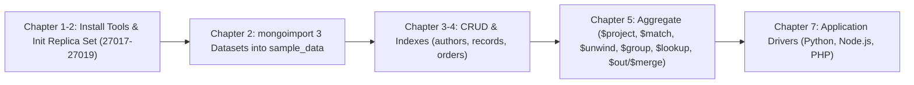

# MongoDB Essential Training

This is the repository for the LinkedIn Learning course `MongoDB Essential Training`. The full course is available from [LinkedIn Learning][lil-course-url].

Browse the full English [Diátaxis documentation](docs/index.md) for guided setup labs, ASD-STE100 operational procedures, dataset/chapter references, and replica set architecture notes.

## Instructions

All instructions and commands used in the course are organized by chapter (`1/` through `7/`) for copy-paste and study access.

The datasets used in this course are stored in the [datasets folder](datasets/). Import all three JSON datasets into your `sample_data` database:

```bash
mongoimport --db=sample_data datasets/inventory.json
mongoimport --db=sample_data datasets/movies.json
mongoimport --db=sample_data datasets/orders.json
```

## Course Workflow Overview



| Directory | Chapter / Topic | Contents |
| :--- | :--- | :--- |
| `1/` | Environment Setup | `1_2.sh` (macOS), `1_3.sh`, `1_4.sh` |
| `2/` | Server, Replica Sets & Import | `2_1.sh`–`2_5.sh`, `m1.conf`–`m3.conf` (`mongodb-essentials-rs`) |
| `3/` | Basic CRUD & Indexes | `3_2.sh`, `3_3.sh`, `3_4.sh`, `3_6.sh` |
| `4/` | Queries, Updates, Arrays & Transactions | `4_2.sh`–`4_11.sh` |
| `5/` | Aggregation Pipelines | `5_2.sh`–`5_10.sh` (`5_3.sh` blank placeholder) |
| `6/` | Additional Blog Insert Snippet | `6_3.sh` |
| `7/` | Driver Quickstarts | `python/main.py`, `nodejs/index.js`, `php/index.php`, `7_2.sh`–`7_4.sh` |
| `datasets/` | Sample JSON Datasets | `inventory.json`, `movies.json`, `orders.json` (`1,000` records each) |

## Verification

Run the automated offline validation suite (Python, Node.js, PHP syntax checks, YAML/JSON validation, Diátaxis, STE, and Mermaid checks):

```bash
python -B -m unittest discover -s tests -p "test_*.py" -v
```

[lil-course-url]: https://www.linkedin.com/learning/mongodb-essential-training
