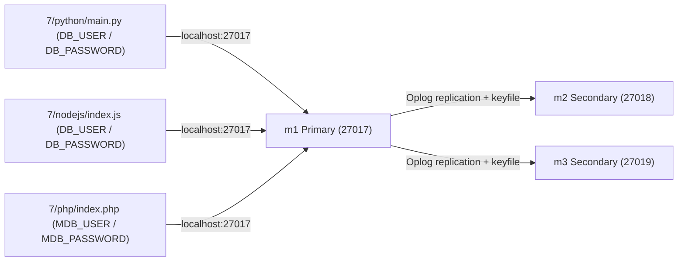

# Replica Set and Driver Architecture

Deploying three `mongod` processes in `2/` (`mongodb-essentials-rs`) teaches replica set elections, keyfile internal auth, and driver connectivity across three programming runtimes.

## Topology and Application Connections

- **Auth database parameter (`admin`):** All three Chapter 7 drivers authenticate against `?retryWrites=true&w=majority` on the `admin` database (`naomi` root user created during `2_4.sh`) while reading and writing collections inside `sample_data`.
- **Client vs bind address (`localhost` vs `0.0.0.0`):** `mongod` configs use `bindIp: localhost` to prevent network exposure; updating `7/nodejs/index.js` from `0.0.0.0` to `localhost` keeps cross-OS client connections consistent across Linux, macOS, and Windows.
- **Env variable naming:** Python and Node.js reuse `DB_USER`/`DB_PASSWORD` via `dotenv`, while PHP uses `MDB_USER`/`MDB_PASSWORD`, so `.env` templates differ slightly per language folder.
